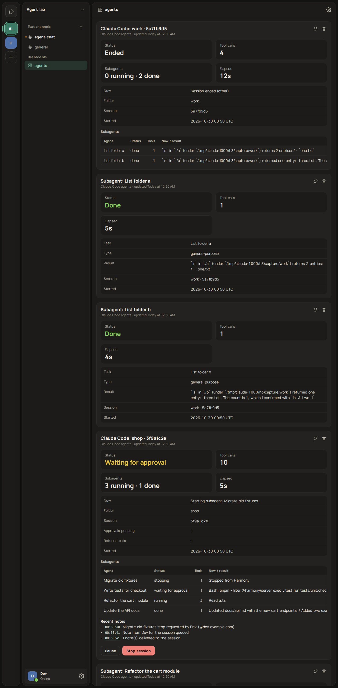
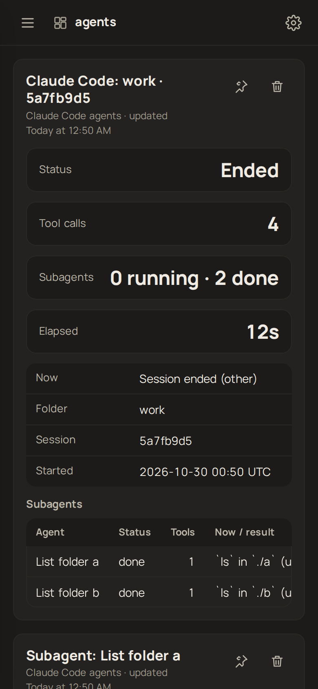

# The agent hub

Harmony as a control plane for AI agents: an agent works through a bot, people see what it is doing, and nothing with a side effect happens until a person with the right permission presses a button. It is built from parts that already exist (bots, gateway delivery, panels, buttons with `requiredPermission`) plus the [MCP server](../packages/mcp/README.md) and a Claude Code hook.

| Desktop: a run waiting on an approval                                  | Phone: the approval message                                                         |
| ---------------------------------------------------------------------- | ----------------------------------------------------------------------------------- |
|  |  |

## The pieces

**Approvals (`request_approval`).** The agent posts a message with Approve and Deny buttons. Both buttons carry `requiredPermission` (default `manage_messages`), which the server checks on every click, so a member without it gets `403 missing_permission` and never reaches the agent. High-risk requests put a confirmation dialog on Approve. The click arrives at the MCP process as an `interaction.create` frame over the bot's WebSocket; the process answers the clicker with an ephemeral note, resolves the tool call, edits the message to **Approved by X** / **Denied by X** / **Timed out** / **Cancelled** with the time, and removes the buttons. The result `{decision, by, at}` goes back to the model.


**Runs (`start_run`, `update_run`, `finish_run`).** A run is a panel (`run-<id>`) in a channel, ideally a dashboard channel such as `#agents`: status (running, waiting for approval, waiting for reply, done, failed, cancelled), current step, step count with an optional progress bar, elapsed time, the last five notes and an optional link. The MCP process merges updates: at most one panel write per run per second (`HARMONY_PANEL_MIN_INTERVAL_MS`), the newest state always wins, and the elapsed time is refreshed every 30 seconds while the run is active. The server's own limit (`PANEL_RATE_MAX`) is never approached. A channel holds 20 panels; when it is full, `start_run` deletes the bot's own oldest finished run panel to make room.

**Cancel.** An active run panel has a **Cancel run** button, also gated by the permission. The click marks the run cancelled, aborts anything waiting on it (a pending approval returns `cancelled` and its message is edited), and from then on every tool call returns `This run was cancelled by X; stop working.` until the agent calls `start_run` again. This relies on the model obeying a tool result, which is a request, not a kill switch: revoking the token or removing the bot from the server is the hard stop.

**Audit.** There is no audit table. Every approval, denial, timeout and cancel is an edited message in the channel (who, when, what) and a line in the run panel's notes. Messages are kept with the channel, so the history is as durable as the chat.

**Claude Code.** `harmony-hook` (second bin of the MCP package) turns Claude Code's own `PreToolUse`, `Notification` and `Stop` hooks into the same flow: a `git push` or `rm -rf` becomes an approval message, and the person's click becomes the hook's `allow` or `deny`. It fails safe to `ask` (Claude Code's normal terminal prompt) on any error and never runs past a hard timeout. Setup and the verified hook schema are in the [package README](../packages/mcp/README.md#claude-code-hook-harmony-hook).

**One connection per process (direct mode).** The MCP server keeps one WebSocket to Harmony for waits, approvals and Cancel together (reconnecting, resubscribing and catching up after a drop). The hook is short-lived and opens its own for each approval, and Harmony delivers a click to a bot's newest connection, so keep **one approval-waiting process per bot** at a time; give concurrent Claude Code sessions their own bots. With the [control room](#agent-control-room) the daemon is that one process for every session, and the limit goes away.

## Agent-to-agent safety

Bots reading each other's messages can loop. Harmony limits this on the server, in the bot path of the message service, so the human send path is unchanged (still six statements, `modules-hotpath.test.ts`):

- **Hop count.** Every message has a `hops` count (migration `0025`, a `smallint` written in the same `INSERT`). A bot message that replies to another bot's message carries the parent's count plus one; one that only mentions another bot starts at 1; a bot continuing its own thread does not add a hop; anything a person or a webhook writes is 0, so a person speaking resets the chain. A bot message beyond `BOT_MAX_HOPS` (default 8) is refused with `429 bot_loop`.
- **Budget.** At most `BOT_BUDGET_MAX` (30) bot-to-bot messages per channel per `BOT_BUDGET_WINDOW_SECONDS` (60), counted in Redis; the next is refused with `429 bot_budget`.
- **Client side.** `wait_for_reply` and `ask_human` ignore bots unless `includeBots` is set, and the MCP server caps its own sends per minute.

Both refusals are plain `429`s with a `code`, so an agent that hits them is told why; an operator tunes them with the environment variables above.

## Threat model

- **Chat is untrusted input.** Anyone who can post where the agent reads can try to instruct it (prompt injection). The tool descriptions and transcripts say so, but a model can still be talked into things. Design so that being talked into something is not enough.
- **Approvals are the control for side effects.** What an injected instruction can do is limited to what the agent can do without a person: the decision comes from a button press by someone the server verified, never from message text. Put every irreversible action behind `request_approval` (or the hook's pattern). Keep the approval channel one the agent cannot be steered through, and use `requiredPermission` to restrict who may approve (for example a role-based key such as `manage_guild`).
- **The agent cannot approve itself.** Clicks go through `POST /api/interactions/actions`, which is human-only (`humanOnly`: a bot token is refused), and the permission check runs on the clicker, not on the bot.
- **What approvals do not cover.** The approval shows what the agent _says_ it will do. An agent that lies in `title` and `details`, or approves one thing and runs another, is not caught here; in the hook, the shown text is the actual command, which is why it is the safer integration for shell access. A person approving without reading defeats it, and a high-risk flag only adds a second click.
- **Tokens and scopes.** The bot token is the agent's whole identity: give it only the scopes it needs (`messages.read`, `messages.write`, `channels.read`, `panels.write`, `commands`), add it only to the servers and channels it works in, and keep it out of repositories (`.claude/settings.local.json` is for this). Rotate it in _Settings > Bots_ if it leaks; the old one stops working at once. The hook and the MCP server never print the token.
- **Disclosure.** Approval messages, run panels and notifications are visible to everyone in the channel. The hook leaves prompt and reply text out unless `HARMONY_HOOK_INCLUDE_TEXT=1`, because they can contain code and secrets, and it neutralises `<@id>` and `@everyone` in text a model wrote.
- **Availability.** A click needs the agent process connected. While it is down the person sees `unreachable`; the agent keeps waiting and reconnects, and an approval that times out counts as no.

## Agent control room

The hook and the MCP tools show one agent at a time. The control room shows **every Claude Code session and every subagent it spawns**, lets people stop, pause or steer them from Harmony, and keeps approvals working for all of them. It adds one piece, a small local daemon, and changes nothing on the server.

| Desktop: a session with four subagents (one stopped, one waiting for approval) | Phone: the same dashboard                                                     |
| ------------------------------------------------------------------------------ | ----------------------------------------------------------------------------- |
|             |  |

### Why a daemon

`harmony-hook` is one short process per hook event. It cannot receive a button click after it exits, and it cannot see two subagents as parts of one session. So the hook hands every event to **`harmony-agentd`**, a local daemon (one per user and bot, started on demand by the first hook, detached) that holds the **one gateway socket**, owns all panels and receives all clicks. That also removes the old "one approval-waiting process per bot" limit: approvals now go through the daemon too.

- **Start and single instance.** The hook connects to a unix socket (`$XDG_RUNTIME_DIR/harmony-agentd/`, else `~/.cache/harmony-agentd/`; directory mode 700, socket mode 600, named after a hash of the URL and the token). If nothing answers it takes a lock directory, starts the daemon and waits up to 2.5 s for the socket; hooks that arrive meanwhile wait on the lock instead of starting a second one. The daemon also takes a pidfile and refuses to run when a live one holds it. If the start fails, hooks leave it alone for 60 s (`*.failed` marker) so a broken setup does not slow every tool call.
- **Idle exit.** With no live session for `HARMONY_AGENTD_IDLE_MINUTES` (30) it closes the socket and exits. A session that goes quiet for `HARMONY_AGENTD_STALE_MINUTES` (30) without a `SessionEnd` (a killed terminal) is marked ended. While no session is live the daemon holds no gateway socket.
- **Fail-safe.** The hook answers within a short timeout. If the daemon cannot be reached it falls back to the old direct behaviour (approvals and notes straight from the hook; a tool call no rule selects gets no decision). If the daemon acknowledged a wait (an approval or a pause) and then vanished, a `PreToolUse` answers `ask`. The hook always exits 0.
- **State is in memory.** A daemon restart forgets stop flags, queued notes and panel state; the next events rebuild the panels, and panels an earlier daemon left behind are deleted when the new one starts.

### What people see

Set `HARMONY_DASHBOARD_CHANNEL` to a dashboard channel (for example `#agents`; the bot needs `panels.write`).

- **One session panel per Claude Code session**: title (folder name and an 8-character session id), status (running, waiting for approval, waiting for input, idle, paused, stopping, ended), what the main agent is doing, tool-call count, subagents running and done, approvals pending, start time and elapsed time, a table of the subagents (running first, then the latest finished, with their result), and the last notes (stops, pauses, approvals, delivered messages).
- **One panel per subagent**: task (the description the orchestrator gave it), agent type, status, current activity (`Edit apps/server/src/x.ts`, `Bash: pnpm test:unit`), tool-call count, elapsed time, and when it finishes the first lines of its final answer.
- **Cleanup.** Each panel is written at most once per second (changes coalesce; the newest state always wins) and all panels share a small gap between writes, so many subagents stay far under the server's `PANEL_RATE_MAX`. Per session the newest `HARMONY_AGENTD_KEEP_FINISHED` (10) finished subagents keep a panel; older ones are deleted (the session's counter still counts them). The newest `HARMONY_AGENTD_KEEP_ENDED` (2) ended sessions keep their panels. If the channel still reaches 20 panels, the oldest finished subagent panel, then the oldest ended session, is deleted to make room. Panels appear in creation order (the server's `position`); the web client does not reorder them.
- **Safe to show.** Only the tool name and where it works are shown: file paths (relative to the folder), a Bash command (one line, cut), a search pattern, a web host. Never file contents, edit text, MCP tool input or environment values. Everything goes through `redact.ts` first: token-shaped strings (bot, GitHub, Slack, AWS, JWT, `sk-`), `NAME=value` where the name says secret, `--password x` style flags, `Authorization` headers, `user:pass@` URLs, private key blocks and long mixed letter-and-digit strings become `[redacted]`. A command that contained a secret is shown by its first word only, and commands that read secrets (`env`, `printenv`, `cat .env`, `echo $TOKEN`, `docker inspect`) are not shown at all. The prompt text is never shown unless `HARMONY_HOOK_INCLUDE_TEXT=1`. This is pattern matching: it catches what looks like a secret, not every secret, which is why the panel never carries contents.

### How a subagent gets its name

`SubagentStart` carries only `agent_id` and `agent_type`. The task description is in the parent's `PreToolUse` for the `Agent` tool (`tool_input.description`). The daemon remembers each such call and gives a new subagent the oldest unclaimed call of the same type, so two parallel calls are matched in the order they were issued; that is a best effort. The parent's `PostToolUse` for the same call carries `tool_response.agentId` and the same `tool_use_id`, and the daemon uses it to correct a swapped pair once it arrives (it arrives when the subagent is already done). Without a matching call the panel shows the agent type.

### What people can do

Buttons carry `requiredPermission` (`HARMONY_CONTROL_PERMISSION`, default `manage_messages`), which the server checks on every click, and Stop asks for a confirmation.

- **Stop** a subagent or a whole session. The daemon records a flag. The next `PreToolUse` of that agent (or of any agent of the session) is answered `permissionDecision: "deny"` with a reason that names the person who stopped it and tells it to stop and say where it left off. A pending approval of a stopped session ends as cancelled. Nothing ever answers `decision: "block"` on `Stop` or `SubagentStop`, because that would keep the agent running (the hooks reference: "Prevents Claude from stopping", with an 8-continuation cap), so a stopped agent can always end and no loop is possible. A new prompt typed in the terminal clears a session stop: the person at the keyboard has taken over.
- **Pause and Resume** (session). While paused, every `PreToolUse` of the session waits in the daemon, up to `HARMONY_AGENTD_PAUSE_SECONDS` (120), then is denied with a message saying the session is paused; Resume releases the waiting calls at once. This is safe only because the wait is bounded: Claude Code cancels a hook after its `timeout` (seconds), so the `PreToolUse` timeout in settings must be longer than the pause wait and the approval timeout (the example uses 340).
- **Steer.** With `HARMONY_STEER_CHANNEL` set (a text channel), the daemon posts one status message per session there. A person **replies to it**, or **mentions the bot and starts with the session id** (or a subagent's `Agent id`, shown on its panel), and the note is queued; with exactly one live session the id can be left out. The daemon answers in the channel ("Noted...") and delivers the note as `additionalContext` of the agent's next `PostToolUse` (subagent notes to that subagent, session notes to the main agent), `UserPromptSubmit`, or `Stop` of the main agent (once; not when `stop_hook_active`). `additionalContext` is documented for exactly these events. The text is attributed (`Message from Ada via Harmony: "..."`) and prefixed with a notice that it came from a chat message, not from the terminal user. `HARMONY_STEER_USERS` (comma-separated logins) limits who may steer; bots, webhooks and deleted messages are ignored; at most 10 notes wait per target.
- **Approvals** work as before (`HARMONY_APPROVAL_PATTERN`) and name who asked: "Subagent 'B+C worker' wants to run: git push ...", with the agent type, folder and session in the details. Secret-looking parts of the command are hidden in the message. For Bash the pattern is tested against each part of the command that runs: quoted strings and heredoc bodies are dropped and the rest is split at `;`, `&&`, `||`, `|` and newlines, so anchor it with `^`. A command that only mentions `git push` in an `echo`, a commit message or a heredoc does not ask (it used to, and blocked an agent for the full timeout).

### Setup

1. Create a bot with scopes `messages.read`, `messages.write`, `channels.read`, `panels.write`, `commands`, and **no interactions URL** (clicks must reach its socket). Add it to the server, to a dashboard channel (`#agents`) and to a text channel for approvals and steering.
2. Put the token in a mode-600 file (`HARMONY_BOT_TOKEN=hb_...` or the bare token) and point `HARMONY_BOT_TOKEN_FILE` at it. The hook refuses a file that group or others can read. The token then never sits in `settings.json`; the daemon reads the file itself.
3. Build (`pnpm --filter @harmony/mcp build`) and paste the hooks into `~/.claude/settings.json` or a project's `.claude/settings.local.json`:

```json
{
  "env": {
    "HARMONY_URL": "http://127.0.0.1:8471",
    "HARMONY_BOT_TOKEN_FILE": "/home/you/.config/harmony-agents/bot.env",
    "HARMONY_AGENTD": "1",
    "HARMONY_DASHBOARD_CHANNEL": "#agents",
    "HARMONY_AGENT_CHANNEL": "#agent-chat",
    "HARMONY_STEER_CHANNEL": "#agent-chat",
    "HARMONY_APPROVAL_PATTERN": "^(git push|rm -rf|docker)"
  },
  "hooks": {
    "SessionStart": [
      {
        "hooks": [
          {
            "type": "command",
            "command": "node /path/to/harmony/packages/mcp/dist/hook-bin.js",
            "timeout": 10
          }
        ]
      }
    ],
    "SessionEnd": [
      {
        "hooks": [
          {
            "type": "command",
            "command": "node /path/to/harmony/packages/mcp/dist/hook-bin.js",
            "timeout": 5
          }
        ]
      }
    ],
    "UserPromptSubmit": [
      {
        "hooks": [
          {
            "type": "command",
            "command": "node /path/to/harmony/packages/mcp/dist/hook-bin.js",
            "timeout": 10
          }
        ]
      }
    ],
    "PreToolUse": [
      {
        "matcher": "*",
        "hooks": [
          {
            "type": "command",
            "command": "node /path/to/harmony/packages/mcp/dist/hook-bin.js",
            "timeout": 340
          }
        ]
      }
    ],
    "PostToolUse": [
      {
        "matcher": "*",
        "hooks": [
          {
            "type": "command",
            "command": "node /path/to/harmony/packages/mcp/dist/hook-bin.js",
            "timeout": 10
          }
        ]
      }
    ],
    "SubagentStart": [
      {
        "hooks": [
          {
            "type": "command",
            "command": "node /path/to/harmony/packages/mcp/dist/hook-bin.js",
            "timeout": 10
          }
        ]
      }
    ],
    "SubagentStop": [
      {
        "hooks": [
          {
            "type": "command",
            "command": "node /path/to/harmony/packages/mcp/dist/hook-bin.js",
            "timeout": 10
          }
        ]
      }
    ],
    "Stop": [
      {
        "hooks": [
          {
            "type": "command",
            "command": "node /path/to/harmony/packages/mcp/dist/hook-bin.js",
            "timeout": 10
          }
        ]
      }
    ],
    "Notification": [
      {
        "hooks": [
          {
            "type": "command",
            "command": "node /path/to/harmony/packages/mcp/dist/hook-bin.js",
            "timeout": 10
          }
        ]
      }
    ]
  }
}
```

`PreToolUse` and `PostToolUse` use the matcher `*` because the dashboard follows every tool call; a call no rule selects costs one short process (see the measurement in `NOTES.md`). Narrow the matcher (`Bash|Edit|Write`) to show less. All hooks use `"type": "command"`; timeouts are seconds. Settings are read when a session starts. A running daemon keeps the settings it started with: `harmony-agentd stop` after changing them.

`harmony-agentd status` and `harmony-agentd stop` talk to the running daemon; `harmony-agentd` with no argument runs one in the foreground. Its log (`*.log` next to the socket) holds warnings only and never the token.

### Hook facts this relies on

From the [hooks reference](https://code.claude.com/docs/en/hooks), read on 2026-10-29, and checked against real input captured from a headless run (`packages/mcp/tests/fixtures/claude-code-two-subagents.jsonl`):

- Common fields: `session_id`, `transcript_path`, `cwd`, `permission_mode`, `hook_event_name`; `agent_id` and `agent_type` are present "when the hook fires inside a subagent". In the capture, the main agent's events had none, and a subagent's `PreToolUse` and `PostToolUse` carried both.
- `SubagentStart` input is `agent_id` and `agent_type` only ("No blocking or decision control"; `additionalContext` is the one output). `SubagentStop` adds `stop_hook_active`, `agent_transcript_path` and `last_assistant_message`.
- `PreToolUse` output: `hookSpecificOutput.permissionDecision` (`allow`, `deny`, `ask`, `defer`) and `permissionDecisionReason`. An `Agent` call's `tool_input` has `description`, `prompt`, `subagent_type` (captured: also `run_in_background`).
- `PostToolUse` supports `hookSpecificOutput.additionalContext` ("String added to Claude's context alongside the tool result"). `UserPromptSubmit` and `Stop` accept `additionalContext` as well; `Stop` and `SubagentStop` with `decision: "block"` keep the agent working, guarded by `stop_hook_active` and an 8-continuation cap.
- Exit code 0 with JSON is used throughout; any other failure lets the action go ahead. `SessionEnd` hooks have a 1.5 s budget unless `timeout` is longer.
- Captured but not documented in the part read: `SessionStart` has `source` and no model field; the `Agent` tool's `PostToolUse` has `tool_response.agentId`.

### Limits

- Stop is a refusal of tool calls, not a kill. An agent that is only thinking, or waiting on a long tool call, ends at its next call; the model is told why, and a model can still ignore text. Revoking the token or killing the process is the hard stop.
- Pause holds tool calls, not the model. After the pause wait runs out the call is denied, not left hanging.
- The daemon sees what hooks send. Subagents in other sessions or on other machines need their own hooks (and can share the one bot token and channel; give each machine its own daemon).
- Panels of a session are 1 session plus up to 10 finished and all running subagents. With several orchestrators at once lower `HARMONY_AGENTD_KEEP_FINISHED`.
- Messages in the steer channel are matched by reply or mention only. A person without `HARMONY_STEER_USERS` set can steer if they can post in that channel.

### Control room threat model

- **Who can stop or pause**: only people who hold `HARMONY_CONTROL_PERMISSION` in that channel; the server refuses the click otherwise (`403 missing_permission`) and a bot cannot press buttons. **Who can steer**: whoever can post in the steer channel (or the `HARMONY_STEER_USERS` list). Keep the steer channel small, because a note is **untrusted input to the agent**: it can say anything, including "ignore your instructions". The attribution and the notice lower the risk, they do not remove it. Do not give a steered agent permissions it should not have, and keep side effects behind approvals, which a note cannot grant.
- **The daemon is a local control point.** Anyone who can write to its socket can send events, so the socket is mode 600 in a mode-700 directory. It accepts events only; it has no command that reads the token or changes configuration.
- **Tokens never in settings.json**: use `HARMONY_BOT_TOKEN_FILE` (mode 600). The daemon never prints the token and error text has it removed.
- **Disclosure**: panels show tool names, paths, one-line redacted commands and the first lines of subagent answers to everyone in the dashboard channel. Use a private channel for sensitive work; set `HARMONY_AGENTD_SUMMARY_LINES=0` to leave answers out.

## Try it

[`examples/agent-demo`](../examples/agent-demo/README.md) is a scripted agent that uses the MCP server through the MCP SDK client: it starts a run, updates steps, asks for approval, waits, and finishes. `apps/web/e2e/agent-hub.spec.ts` runs it against the dev stack and presses the buttons as a person.
