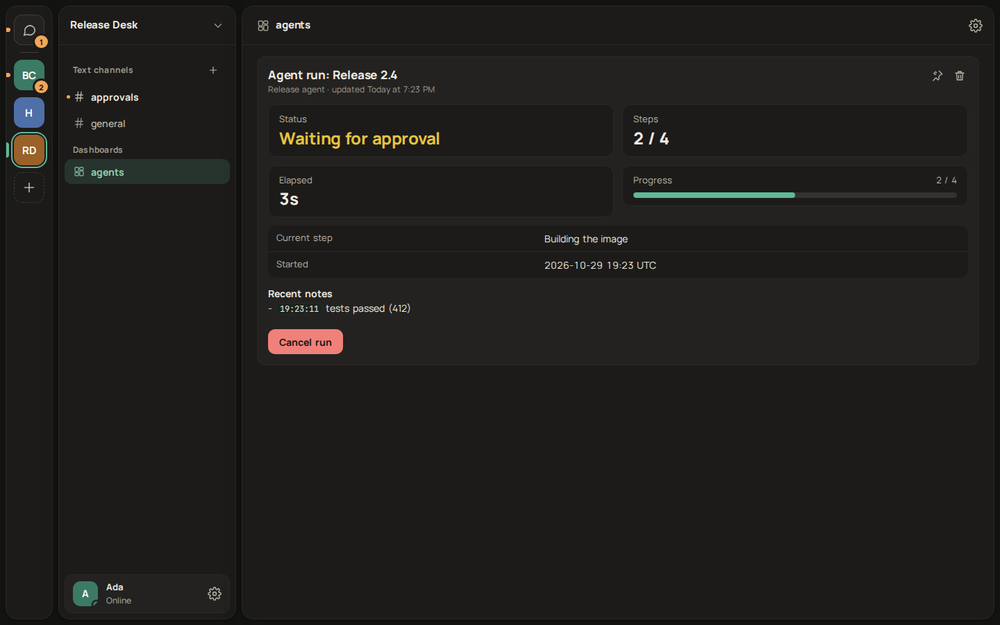
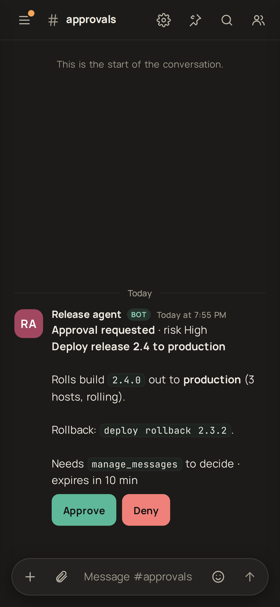
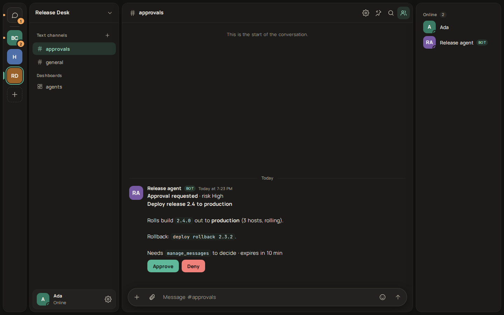

# The agent hub

Harmony as a control plane for AI agents: an agent works through a bot, people see what it is doing, and nothing with a side effect happens until a person with the right permission presses a button. It is built from parts that already exist (bots, gateway delivery, panels, buttons with `requiredPermission`) plus the [MCP server](../packages/mcp/README.md) and a Claude Code hook.

| Desktop: a run waiting on an approval                                  | Phone: the approval message                                                         |
| ---------------------------------------------------------------------- | ----------------------------------------------------------------------------------- |
|  |  |

## The pieces

**Approvals (`request_approval`).** The agent posts a message with Approve and Deny buttons. Both buttons carry `requiredPermission` (default `manage_messages`), which the server checks on every click, so a member without it gets `403 missing_permission` and never reaches the agent. High-risk requests put a confirmation dialog on Approve. The click arrives at the MCP process as an `interaction.create` frame over the bot's WebSocket; the process answers the clicker with an ephemeral note, resolves the tool call, edits the message to **Approved by X** / **Denied by X** / **Timed out** / **Cancelled** with the time, and removes the buttons. The result `{decision, by, at}` goes back to the model.

**Runs (`start_run`, `update_run`, `finish_run`).** A run is a panel (`run-<id>`) in a channel, ideally a dashboard channel such as `#agents`: status (running, waiting for approval, waiting for reply, done, failed, cancelled), current step, step count with an optional progress bar, elapsed time, the last five notes and an optional link. The MCP process merges updates: at most one panel write per run per second (`HARMONY_PANEL_MIN_INTERVAL_MS`), the newest state always wins, and the elapsed time is refreshed every 30 seconds while the run is active. The server's own limit (`PANEL_RATE_MAX`) is never approached. A channel holds 20 panels; when it is full, `start_run` deletes the bot's own oldest finished run panel to make room.

**Cancel.** An active run panel has a **Cancel run** button, also gated by the permission. The click marks the run cancelled, aborts anything waiting on it (a pending approval returns `cancelled` and its message is edited), and from then on every tool call returns `This run was cancelled by X; stop working.` until the agent calls `start_run` again. This relies on the model obeying a tool result, which is a request, not a kill switch: revoking the token or removing the bot from the server is the hard stop.

**Audit.** There is no audit table. Every approval, denial, timeout and cancel is an edited message in the channel (who, when, what) and a line in the run panel's notes. Messages are kept with the channel, so the history is as durable as the chat.

**Claude Code.** `harmony-hook` (second bin of the MCP package) turns Claude Code's own `PreToolUse`, `Notification` and `Stop` hooks into the same flow: a `git push` or `rm -rf` becomes an approval message, and the person's click becomes the hook's `allow` or `deny`. It fails safe to `ask` (Claude Code's normal terminal prompt) on any error and never runs past a hard timeout. Setup and the verified hook schema are in the [package README](../packages/mcp/README.md#claude-code-hook-harmony-hook).

## Agent-to-agent safety

Bots reading each other's messages can loop. Harmony limits this on the server, in the bot path of the message service, so the human send path is unchanged (still six statements, `modules-hotpath.test.ts`):

- **Hop count.** Every message has a `hops` count (migration `0023`, a `smallint` written in the same `INSERT`). A bot message that replies to another bot's message carries the parent's count plus one; one that only mentions another bot starts at 1; a bot continuing its own thread does not add a hop; anything a person or a webhook writes is 0, so a person speaking resets the chain. A bot message beyond `BOT_MAX_HOPS` (default 8) is refused with `429 bot_loop`.
- **Budget.** At most `BOT_BUDGET_MAX` (30) bot-to-bot messages per channel per `BOT_BUDGET_WINDOW_SECONDS` (60), counted in Redis; the next is refused with `429 bot_budget`.
- **Client side.** `wait_for_reply` and `ask_human` ignore bots unless `includeBots` is set, and the MCP server caps its own sends per minute.

Both refusals are plain `429`s with a `code`, so an agent that hits them is told why; an operator tunes them with the environment variables above.

## Threat model

- **Chat is untrusted input.** Anyone who can post where the agent reads can try to instruct it (prompt injection). The tool descriptions and transcripts say so, but a model can still be talked into things. Design so that being talked into something is not enough.
- **Approvals are the control for side effects.** What an injected instruction can do is limited to what the agent can do without a person: the decision comes from a button press by someone the server verified, never from message text. Put every irreversible action behind `request_approval` (or the hook's pattern). Keep the approval channel one the agent cannot be steered through, and use `requiredPermission` to restrict who may approve (for example a role-based key such as `manage_guild`).
- **The agent cannot approve itself.** Clicks go through `POST /api/interactions/actions`, which is human-only (`humanOnly`: a bot token is refused), and the permission check runs on the clicker, not on the bot.
- **What approvals do not cover.** The approval shows what the agent _says_ it will do. An agent that lies in `title` and `details`, or approves one thing and runs another, is not caught here; in the hook, the shown text is the actual command, which is why it is the safer integration for shell access. A person approving without reading defeats it, and a high-risk flag only adds a second click.
- **Tokens and scopes.** The bot token is the agent's whole identity: give it only the scopes it needs (`messages.read`, `messages.write`, `channels.read`, `panels.write`, `commands`), add it only to the servers and channels it works in, and keep it out of repositories (`.claude/settings.local.json` is for this). Rotate it in _Settings > Bots_ if it leaks; the old one stops working at once. The hook and the MCP server never print the token.
- **Disclosure.** Approval messages, run panels and notifications are visible to everyone in the channel. The hook leaves prompt and reply text out unless `HARMONY_HOOK_INCLUDE_TEXT=1`, because they can contain code and secrets, and it neutralises `<@id>` and `@everyone` in text a model wrote.
- **Availability.** A click needs the agent process connected. While it is down the person sees `unreachable`; the agent keeps waiting and reconnects, and an approval that times out counts as no.

## Try it

[`examples/agent-demo`](../examples/agent-demo/README.md) is a scripted agent that uses the MCP server through the MCP SDK client: it starts a run, updates steps, asks for approval, waits, and finishes. `apps/web/e2e/agent-hub.spec.ts` runs it against the dev stack and presses the buttons as a person.
