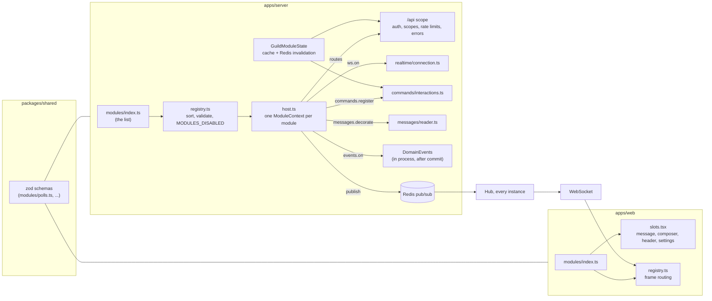

# Modules

Harmony is built from a small core and a set of modules. The core is authentication, users, guilds,
channels, messages, the realtime hub, presence, and the bot, webhook and command infrastructure.
Everything else (reactions, pins, search, uploads, polls, a coin flip) is a module: a folder with
one object that says what it adds. A module can add routes, WebSocket frames, slash commands, data
on messages, database tables, per-server settings, and UI. A server's owner can switch optional
modules off for that server, and an operator can switch any module off for the whole instance.

- [Architecture](#architecture)
- [The contract](#the-contract)
- [Lifecycle and ordering](#lifecycle-and-ordering)
- [Hot-path guarantees](#hot-path-guarantees)
- [Per-guild state](#per-guild-state)
- [Slash commands](#slash-commands)
- [The web side](#the-web-side)
- [Write a module in 15 minutes](#write-a-module-in-15-minutes)
- [What the shipped modules own](#what-the-shipped-modules-own)

## Architecture



A module is listed in two places: `apps/server/src/modules/index.ts` and, if it has UI,
`apps/web/src/modules/index.ts`. Adding one is an import line in each plus a folder.

## The contract

```ts
interface HarmonyModule {
  id: string; // 'polls': kebab-case, also the prefix of its frames
  name: string;
  description: string;
  optional: boolean; // optional modules can be switched off per server
  dependsOn?: string[];
  migrationsDir?: string; // Kysely migrations the module owns
  config?: ZodType; // environment variables it reads, parsed once
  guildSettings?: ZodType; // per-server settings; every field needs a default
  coreFrames?: string[]; // core frame types it may publish (reactions only)
  register(ctx: ModuleContext): void | Promise<void>;
  registerWorker?(ctx: WorkerModuleContext): void | Promise<void>;
}
```

`register` receives a `ModuleContext`. It offers narrow, typed extension points and not the app.

| Extension point                                                                                                             | What it does                                                                                                                                                                                                                                                                                                                                  |
| --------------------------------------------------------------------------------------------------------------------------- | --------------------------------------------------------------------------------------------------------------------------------------------------------------------------------------------------------------------------------------------------------------------------------------------------------------------------------------------- |
| `ctx.routes(app => ...)`                                                                                                    | Fastify routes mounted under `/api`. Authentication, bot scopes (`config.scope`), rate limits and error handling apply. A route that declares `config: { module: '<id>', moduleScope: 'guild' \| 'channel' \| 'message' }` answers `404 module_disabled` for servers that switched the module off; `:id` names the guild, channel or message. |
| `ctx.requireEnabled(guildId)`                                                                                               | The same check for code that already knows the guild (`null`, a DM, always passes).                                                                                                                                                                                                                                                           |
| `ctx.ws.on(type, schema, handler, opts)`                                                                                    | A client-to-server frame named `<moduleId>.<name>`, validated with your schema. Bots may send it only if `opts.scope` is given and the bot holds it. Unknown types are still `invalid_frame`.                                                                                                                                                 |
| `ctx.events.on(name, handler)`                                                                                              | In-process reaction to `message.created/updated/deleted`, `reaction.added/removed`, `member.joined/left`, `channel.created`. Fired after commit, never awaited, errors logged and isolated. Skipped for servers that switched an optional module off. Not the outbox and not Redis.                                                           |
| `ctx.messages.decorate(fn)`                                                                                                 | Attach data to message payloads: `(messageIds, db) => Map<id, data>`. Called once per page, only for messages carrying the module's marker. The data lands in `message.modules[moduleId]`.                                                                                                                                                    |
| `ctx.messages.sendMarked(input, setup)`                                                                                     | Send a message that carries the module's marker; `setup(trx, messageId)` writes the module's rows in the same transaction.                                                                                                                                                                                                                    |
| `ctx.messages.update / find / load / reader`                                                                                | Helpers for modules that work on messages (pins), including the message-API-shaped reader for your own queries.                                                                                                                                                                                                                               |
| `ctx.commands.register(def)`                                                                                                | A built-in slash command, answered in-process. See [Slash commands](#slash-commands).                                                                                                                                                                                                                                                         |
| `ctx.publish.channel(id, frame)` / `.user(id, frame)`                                                                       | Publish a frame through Redis, so every instance delivers it to its own sockets. The frame type must start with `<moduleId>.` (or be listed in `coreFrames`).                                                                                                                                                                                 |
| `ctx.db`, `ctx.log`, `ctx.config`                                                                                           | Database handle, a logger that tags every line with the module id, and your parsed environment.                                                                                                                                                                                                                                               |
| `ctx.settings.get(guildId)`                                                                                                 | The server's settings, typed by `guildSettings`. Cached; no query per call.                                                                                                                                                                                                                                                                   |
| `ctx.permissions.define(key, text)`                                                                                         | Declares `<moduleId>.<key>` for the role system. Stored and reported with the module; nothing enforces it yet.                                                                                                                                                                                                                                |
| `ctx.channels.requireMember`, `ctx.outbox.enqueue`, `ctx.limiter`, `ctx.storage`, `ctx.redis`, `ctx.onReady`, `ctx.onClose` | Small helpers: access checks, bot events, a Redis-backed rate limiter, file storage, a Redis handle for locks, lifecycle hooks.                                                                                                                                                                                                               |

`registerWorker` runs in the worker process, which loads the same module list. It gets `ctx.db`,
`ctx.config`, `ctx.log` and `ctx.every(name, intervalMs, job)` for periodic jobs.

## Lifecycle and ordering

1. **List and validate.** `modules/index.ts` is the single list. `sortModules` rejects a malformed or
   reserved id (`message`, `reaction`, `guild`, ... belong to the core protocol), a duplicate id, a
   missing dependency and a dependency cycle (with the cycle in the message), and a `guildSettings`
   schema with a field that has no default.
2. **Disable.** `MODULES_DISABLED=polls,coinflip` removes modules for the instance. An unknown name,
   or disabling a module another running module depends on, stops startup with a clear error.
3. **Migrate.** The `migrate` job runs the core migrations, then each module's in dependency order,
   including modules `MODULES_DISABLED` turns off, so the schema is always complete.
4. **Register.** The app builds a context per module and calls `register`, in dependency order, after
   authentication, rate limiting and the core routes are in place.
5. **Ready and close.** `ctx.onReady` hooks run once the server listens; `ctx.onClose` hooks run in
   reverse order on shutdown.

Migrations: each module has a history table of its own (`harmony_module_<id>_migration`) and the
core keeps `kysely_migration`. Core migrations already applied are untouched and still recognized.
A module's history cannot disagree with the core's order, and removing a module from the build
does not break anyone's history. The cost is one extra table pair per module.

## Hot-path guarantees

Sending a message is the hottest write path (6 statements, see [performance](performance.md)). Modules
are built so they add nothing to it unless they need to:

- `DomainEvents.emit` is a map lookup when nobody listens, and never awaits handlers.
- The marker is a column on the message insert (`modules text[]`, default empty): no extra statement.
- Decorators run only for rows whose marker names a module, and in one batched call per module per
  page. A plain message costs a `length` check.
- Per-guild state is cached in process and invalidated over Redis; a guild is read from Postgres once
  per five minutes at most, and only when something asks about it. The shipped modules do not ask on
  the send path, and `tests/integration/modules-hotpath.test.ts` asserts the statements of a send are
  identical with and without them. A module that registers a `message.created` handler pays for the
  state lookup in that handler, off the request path.
- Module frames use the same Redis topics as core events. The hub tries the core schema first, so
  core frames are parsed exactly as before.

## Per-guild state

`guild_modules (guild_id, module_id, enabled, settings jsonb, updated_at)`. A missing row means
defaults: optional modules are enabled, settings are the schema's defaults.

- `GET /api/guilds/:id/modules` lists every module with its state, a JSON Schema of its settings
  (derived from the zod schema; `title` and `description` set with `.meta()` label the form) and the
  permissions it declared. Any member can read it.
- `PUT /api/guilds/:id/modules/:moduleId` with `{enabled?, settings?}` is for the owner or an
  instance admin. Settings are merged into the current ones and validated. Modules that are not
  optional answer `409 module_required`; `dependsOn` is enforced both ways (`dependency_disabled`,
  `module_in_use`).
- Every write sends `guild.modules_updated` to each member so open clients update at once, and
  publishes the guild id on Redis so every instance drops its cached copy.

## Slash commands

Built-in commands share the namespace of bot commands in each server:

- A built-in name is **reserved**: a bot cannot register it (`409 command_conflict`).
- At invocation the built-in **wins**, but only in servers where its module is enabled. A command a
  bot registered before the module existed stays hidden while the built-in is active and works again
  where the module is off.
- `GET /api/guilds/:id/commands` lists both; built-ins have `botId: null`, `botName` set to the module's
  name and `moduleId`.

Options are validated with the same rules and the same autocomplete as bot commands. A handler
returns nothing (it posted something itself), or `{content, embeds?, ephemeral?}`: a public answer is
posted as the caller, an ephemeral one goes to the caller only as `interaction.ephemeral`.

## The web side

`apps/web/src/modules/` mirrors the server: each folder exports a `WebModule`, listed in `index.ts`.

```ts
interface WebModule {
  id: string; // the server module's id
  frames?: { type; schema; reduce(frame, store) }[];
  messageData?: Schema; // shape of message.modules[id]; invalid data is ignored
  messageAccessory?: Component; // under the message when message.modules[id] exists
  messageFooter?: Component; // under every message (reactions)
  messageToolbar?: Component; // desktop hover toolbar
  messageSheet?: Component; // phone action sheet
  messageActions?: { id; icon; label; onSelect }[]; // "more" menu and action sheet
  composerActions?: { id; icon; label; onSelect(ctx) }[]; // ctx.openDialog(Dialog)
  channelHeaderActions?: Component; // header buttons
  channelPanel?: { label; icon; Panel }; // a panel beside the messages, with its header toggle
  guildSettingsPanel?: Component; // extra content in the module's card on Server settings, Modules
  userSettingsPanel?: { label; Panel }; // a page in User settings
}
```

The client loads each server's module state when you open it, and keeps it current from
`guild.modules_updated`. Every slot of a module that is switched off is hidden. Until a server's state
has loaded, modules are treated as on (the server default). Module frames reach the store through
`routeModuleFrame`, which validates them with the module's schema and calls its reducer.

Server settings, Modules lists every module with a switch and builds a settings form from the JSON
Schema: booleans, numbers, enums and strings. Anything else needs a `guildSettingsPanel`.

## Write a module in 15 minutes

This is the `/coinflip` module that ships in the repository, built step by step.

**1. Make a folder and one file**, `apps/server/src/modules/coinflip/index.ts`:

```ts
import { randomInt } from 'node:crypto';
import { defineModule } from '../types.js';

export const coinflip = defineModule({
  id: 'coinflip',
  name: 'Coin flip',
  description: 'Flip a coin with /coinflip.',
  optional: true,

  register(ctx) {
    ctx.commands.register({
      name: 'coinflip',
      description: 'Flip a coin',
      options: [{ name: 'private', description: 'Only show the result to you', type: 'boolean' }],
      handler: ({ user, options }) => ({
        content: `${user.displayName} flipped ${randomInt(2) === 0 ? 'heads' : 'tails'}.`,
        ephemeral: options['private'] === true,
      }),
    });
  },
});
```

**2. List it** in `apps/server/src/modules/index.ts`: one import and one entry in the array.

**3. Run it.** Start the server. `/coinflip` shows up in the slash autocomplete of every server, and
Server settings, Modules lists "Coin flip" with a switch. `MODULES_DISABLED=coinflip` removes it.

**4. Test it** (`apps/server/tests/integration/modules.test.ts`, "built-in coin flip"): invoke the
command through `POST /api/channels/:id/commands`, expect a message "... flipped heads." or "tails."
authored by the caller, with `private: true` expect an `interaction.ephemeral` frame and no message,
and after switching the module off in a server expect `404`.

**5. Need more?** Each step is another line in `register`:

- Data of your own: add `migrationsDir: fileURLToPath(new URL('./migrations', import.meta.url))` and
  a Kysely migration file there. Use `trx.withTables<YourTables>()` for typed queries.
- Settings: `guildSettings: z.object({ limit: z.number().int().default(3) })`, read with
  `await ctx.settings.get(guildId)`. The settings form appears by itself.
- Show something under a message: `ctx.messages.sendMarked(input, setup)` to create it, `decorate` to
  load it, a `messageAccessory` in the web module to draw it. `modules/polls` is the full example.
- Live updates: `ctx.publish.channel(channelId, { type: 'yourmodule.changed', ... })` and a `frames`
  entry in the web module.

## What the shipped modules own

| Module      | Optional | Owns                                                                                                                        |
| ----------- | -------- | --------------------------------------------------------------------------------------------------------------------------- |
| `uploads`   | no       | `POST /api/uploads`, `GET /api/attachments/...`, the orphan cleanup, the `UPLOAD_*` settings                                |
| `reactions` | yes      | `PUT/DELETE /api/messages/:id/reactions/:emoji`, the rate limit, the `reaction.*` frames and events                         |
| `pins`      | yes      | `PUT/DELETE /api/messages/:id/pin`, `GET /api/channels/:id/pins`                                                            |
| `search`    | yes      | `GET /api/search`                                                                                                           |
| `polls`     | yes      | `/poll`, `POST /api/channels/:id/polls`, `/api/polls/...`, three tables, `polls.updated`, the `allowMultipleChoice` setting |
| `coinflip`  | yes      | `/coinflip`                                                                                                                 |

The tables and fields these features use that already existed (`message_reactions`, `messages.pinned_at`,
`messages.search`, `attachments`, and the `reactions`, `pinnedAt` and `attachments` fields of a message)
stay in the core schema and payload: history, search and bot events read them, and moving them would
have changed the live database and the protocol. The module owns the behavior, not the columns. When
reactions are switched off in a server, existing reactions are kept and still returned; only writes are
rejected and the UI is hidden.
